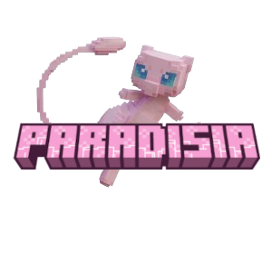

  

<h2 align="center">
  Bienvenue sur Paradisia
</h2>

---

 &nbsp;
 &nbsp;

---

## Le serveur

**Paradisia** est un serveur Minecraft **Cobblemon** : une île où vivent les Pokémon, et seulement eux.

* 🎓 **Le Professeur Chen** t'accueille à ton arrivée, te présente l'île, te remet ton **Pokédex** et te fait choisir ton **starter**
* 🌿 **Un monde 100 % Pokémon** — pas de zombies ni de creepers dans l'overworld : seulement des Pokémon sauvages à capturer
* 🏡 **La ville** — un monde à part où tu peux obtenir **ton propre terrain** auprès du maire, **Rudzee**, et y construire ce que tu veux
* 💰 **Une vraie économie** — des pièces de bronze, d'argent et d'or ; ton terrain te coûte un **impôt foncier** chaque semaine, à payer au Professeur Chen
* 🎒 **Et plein d'autres choses** — sac à dos, serrures et clés pour protéger tes coffres, waystones pour voyager, abattage d'arbres entiers, nouveaux meubles et cosmétiques…

---

## Installer le modpack

### 1 — Installer Prism Launcher

Télécharge et installe [**Prism Launcher**](https://prismlauncher.org/download/) (gratuit, Windows / macOS / Linux).

Au premier lancement, connecte ton **compte Microsoft** (celui de Minecraft).

### 2 — Télécharger le modpack

Va sur la [**dernière version du modpack**](https://github.com/Rudze/JAVA-MC-MODS-Paradisia/releases/latest) et télécharge le fichier **`Paradisia-x.x.x.zip`** (dans *Assets*, en bas de la page).

> ⚠️ Ne le décompresse pas, Prism a besoin du `.zip`.

### 3 — L'importer dans Prism

Dans Prism : **Ajouter une instance** → **Importer** → choisis le fichier `.zip` téléchargé → **OK**.

### 4 — Jouer

Double-clique sur l'instance **Paradisia** : le jeu se lance et **te connecte directement au serveur**, pas besoin d'entrer d'adresse. Pour quitter, utilise **Échap → Quitter le jeu**.

> Le premier lancement est un peu long : Prism télécharge Minecraft, Java et les mods.

---

## Accès au serveur

Le serveur est sur **liste blanche** : demande à **Rudzee** de t'ajouter en lui donnant ton **pseudo Minecraft** avant ta première connexion.

---

## Mettre à jour le modpack

Quand une nouvelle version sort, télécharge le nouveau `.zip` et importe-le comme à l'étape 3.
Tu peux ensuite supprimer l'ancienne instance (clic droit → **Supprimer**) — ta progression est enregistrée sur le serveur, tu ne perds rien.

---

## En cas de problème

| Problème | Solution |
|----------|----------|
| « You are not white-listed on this server! » | Demande à Rudzee de t'ajouter à la liste blanche |
| « Serveur indisponible » | Le serveur redémarre sûrement : attends une minute et clique sur **Réessayer** |
| Le jeu plante au démarrage sur **Mac** | Clic droit sur l'instance → **Modifier** → **Paramètres** → **Java** : coche l'installation Java et choisis un **Java 21 récent** (bouton *Détecter* ou *Télécharger Java*) |
| Le jeu est lent | Clic droit sur l'instance → **Modifier** → **Paramètres** → **Java** : ajuste la mémoire (8 Go conseillés, 6 Go minimum) |

---

## Contact

Pour toute question : contact@rudydavid.fr

---

### Soutenir le projet

Laisse une ⭐ si le projet te plaît !
